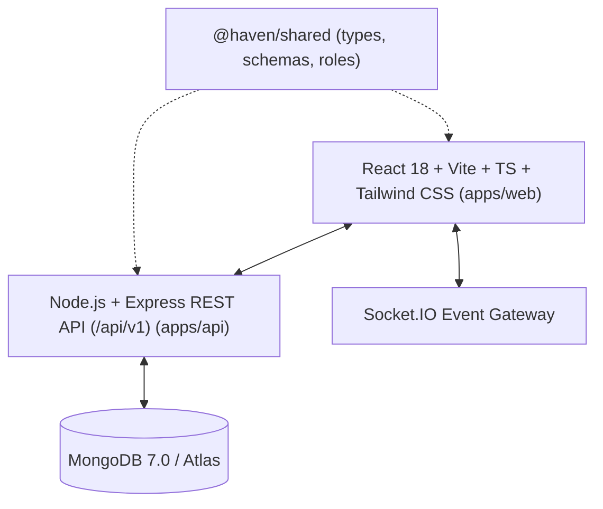

# Haven & Hearth — Complete Luxury Hospitality Platform

[](https://www.typescriptlang.org/)
[](https://nodejs.org/)
[](https://react.dev/)
[](https://www.mongodb.com/)
[](https://tailwindcss.com/)
[](LICENSE)

> **Haven & Hearth** is an interconnected luxury hospitality platform uniting Michelin-caliber culinary discovery, online dining orders, availability-aware table reservations, boutique hotel and suite bookings, in-room dining, high-velocity restaurant POS, real-time Kitchen Display Systems (KDS), pantry inventory, and executive business analytics into a single multi-tenant MERN application.

### 🌐 Live Deployments
- **GitHub Pages**: [https://abdullasheikdev-code.github.io/haven-and-hearth/](https://abdullasheikdev-code.github.io/haven-and-hearth/)
- **Vercel**: [https://temporary-snappy-scarlet-qx0lz71.vercel.app](https://temporary-snappy-scarlet-qx0lz71.vercel.app)
- **Source Code**: [https://github.com/abdullasheikdev-code/haven-and-hearth](https://github.com/abdullasheikdev-code/haven-and-hearth)

---

## 1. Editorial Visual Direction & Design Tokens

Designed with a magazine-quality hospitality identity inspired by boutique hotels (Aman, Soho House, Proper Hotels) and luxury food publications:

- **Warm Ivory & Cream** (`#FBF8F3`, `#F5EFEB`, `#ECE3D8`) — Architectural limestone surfaces
- **Deep Forest Green** (`#1A382B`, `#2A5541`) — Estate botanical heritage
- **Coral & Terracotta** (`#C85A32`, `#DC6B43`) — Open-flame wood hearth accents
- **Mango & Buttery Yellow** (`#EAA838`, `#F7ECCF`) — Warm cellar lighting
- **Charcoal & Espresso** (`#181B19`, `#2C312E`) — High-contrast editorial typography

---

## 2. Core Features & Verified End-to-End Workflows

### 🍽️ Customer Dining & Discovery
- **Restaurant Catalog**: Curated French-Mediterranean and wood-fired open flame dining destinations with cuisine filters, pricing tiers, and opening hours.
- **Interactive Artisanal Menus**: Categories (Mains, Starters, Raw Bar, Cocktails, Desserts), dietary tags (Gluten-Free, Vegetarian), preparation times, and modifiers.
- **Persistent Cart & Checkout**: Persistent cart with authoritative server-side price calculation, tax (8.5%), and gratuity.
- **Real-Time Order Tracking**: Dynamic step-by-step timeline (Pending -> Accepted -> In Prep -> Ready -> Completed) synchronized with live Socket.IO events.

### 🍷 Availability-Aware Table Reservations
- **Live Slot Picker**: Queries available tables by date and party size.
- **Instant Reservation Confirmation**: Generates reservation reference (`RES-xxxx`) and updates table occupancy states on the floor plan.

### 🏨 Boutique Hotel Stays & In-Room Dining
- **Suite Discovery & Availability**: Real-time room availability preventing overlapping bookings.
- **In-Room Dining (Room Service)**: Guests can order dishes directly to their suite (`ORD-xxxx`) and charge the meal to their room folio.

### ⚡ Restaurant Point of Sale (POS)
- **High-Velocity Touch Register**: Instant category tabs, tap-to-add items, table assignment, split bills, and discount percentages.
- **Payment & Receipt Generator**: Cash tendered with live change calculation, credit card sandbox, and printable receipt modal.

### 👨‍🍳 Kitchen Display System (KDS)
- **Kanban Stations**: New Tickets -> Firing on Hearth -> Ready for Service.
- **Live Socket.IO Sync**: New tickets from the web store, POS, or room service appear instantly with sound and live status progression.

### 🧹 Front Desk & Housekeeping
- **Arrivals & Departures**: 1-click Check-In (marks room `OCCUPIED`) and Check-Out (marks room `DIRTY`).
- **Housekeeping Console**: 1-click cleaning status transitions (`DIRTY` -> `IN_PROGRESS` -> `CLEAN` -> `INSPECTED`).

### 📦 Inventory & Procurement
- **Pantry Master Table**: Real-time stock counts, units, minimum thresholds, and low-stock alerts.
- **Purchase Orders & Goods Receipt**: Mark purchase orders received, which automatically increments ingredient stock in MongoDB and logs audit movements.

### 📊 Executive Analytics
- Real-time MongoDB aggregations for sales revenue, average order value, revenue by channel, suite occupancy rate, and pantry asset valuation with CSV export.

---

## 3. Demo Credentials (Ready to Test)

The application includes an interactive floating **Demo Persona Switcher** allowing instant 1-click testing:

| Role | Demo Email | Password | Primary Workspace |
|---|---|---|---|
| **Platform Admin** | `admin@havenandhearth.com` | `HavenDemo2026!` | `/app/reports` |
| **Owner / GM** | `owner@havenandhearth.com` | `HavenDemo2026!` | `/app/overview` |
| **POS Cashier** | `cashier@havenandhearth.com` | `HavenDemo2026!` | `/app/pos` |
| **Kitchen Brigade** | `kitchen@havenandhearth.com` | `HavenDemo2026!` | `/app/kitchen` |
| **Hotel Front Desk** | `reception@havenandhearth.com` | `HavenDemo2026!` | `/hotel/overview` |
| **Housekeeping** | `housekeeping@havenandhearth.com` | `HavenDemo2026!` | `/hotel/housekeeping` |
| **Guest / Customer** | `elena.vance@example.com` | `HavenDemo2026!` | `/` |

---

## 4. Technology Architecture



---

## 5. Local Setup & Installation

### Prerequisites
- **Node.js**: v18+ (tested on Node.js v24)
- **MongoDB**: Active MongoDB service on `mongodb://127.0.0.1:27017` or MongoDB Atlas URI

### Step 1: Clone & Install Dependencies
```bash
git clone <repository-url>
cd "Haven & Hearth"
npm install
```

### Step 2: Seed Demonstration Database
```bash
npm run seed
```

### Step 3: Start Development Servers
Run both API and Web concurrently:
```bash
npm run dev
```
- **Web Storefront & App**: `http://localhost:3000`
- **Backend REST API**: `http://localhost:5000/api/v1`
- **API Health Check**: `http://localhost:5000/api/v1/health`

---

## 6. Testing & Quality Assurance

Run the automated test suite across all packages:
```bash
npm test
```
All tests verify authentication, route guards, restaurant data, availability algorithms, and UI badge rendering.

---

## 7. License & Asset Attribution
- Food & hotel imagery provided via Unsplash License.
- Original custom vector illustrations authored specifically for Haven & Hearth.
- Released under the MIT License.
